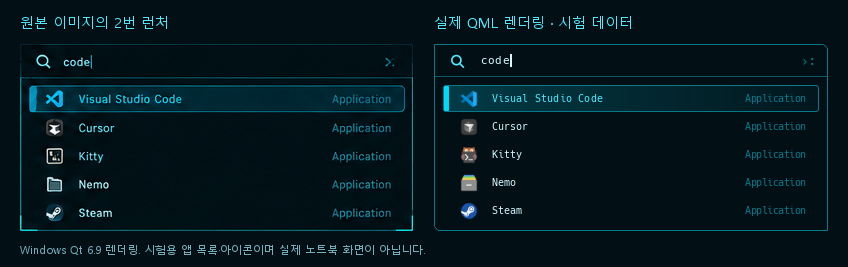

# App Launcher

**Super+Space**로 Shittim 런처를 열고 닫는다. 현재 포커스된 모니터 중앙에 하나만 표시한다. 기존 **Super+R → Fuzzel**은 검증 전까지 유지한다. 앱 이름·일반 이름·키워드·desktop ID를 검색하며, 설치·삭제된 앱은 자동 갱신한다.



원본 패널을 394×187px로 측정했다. 검색 영역은 33px, 목록 시작 위치는 (9, 41), 결과 행은 28px이며 기본 화면에서 5개를 표시한다. 작은 화면에서는 비율을 축소하고 결과는 스크롤한다. 기존 Theme·HudInput·HudText·HudIcon·ControlFrame을 재사용했다. Top Bar와 Control Center의 디자인은 변경하지 않았다.

오른쪽은 실제 `LauncherView.qml`을 Windows Qt 6.9에서 렌더링한 화면이다. 비교를 위해 시험용 목록과 [Papirus 아이콘](https://github.com/PapirusDevelopmentTeam/papirus-icon-theme)을 주입했다. 실제 노트북 화면이 아니며, 이 앱 목록·아이콘 파일은 런처 코드에 들어 있지 않다. 실제 앱 목록은 GIO에서, 아이콘은 현재 Qt 시스템 아이콘 테마에서 읽는다.

## 기존 노트북에 적용

변경분을 받은 뒤 Hyprland의 Kitty에서 실행한다.

```bash
cd ~/projects/shittim
bash scripts/install-packages.sh
bash scripts/setup-launcher.sh --keep-fuzzel
hyprctl reload
bash scripts/session-services.sh
systemctl --user restart shittim.service
bash scripts/verify-launcher.sh
```

추가 공식 패키지는 `python-gobject`, `xdg-terminal-exec`, `hicolor-icon-theme`, `adwaita-icon-theme`이다. `python-gobject`의 의존성으로 GLib/GIO도 설치된다. AUR은 사용하지 않는다. 기존 Fuzzel 패키지를 제거하지 않는다. 설치 과정에서 커널 등이 갱신되어 재부팅이 필요하면 작업 저장 후 직접 재부팅한다.

`setup-launcher.sh`는 기존 설치 자동화와 동일하게 원본 Lua 설정을 보존하고 생성된 진입 설정을 갱신한다. 직접 `dotfiles/hypr/hyprland.lua`를 바꿀 필요가 없다. 저장소 경로에 공백이 있어도 동작하도록 인수를 인용한다. 세션 서비스에 XDG 데이터 디렉터리와 PATH를 전달하므로 사용자 정의 앱 경로·Flatpak export 경로도 세션의 XDG 설정을 따른다.

## 조작

| 입력 | 동작 |
| --- | --- |
| Super+Space | 실행 중인 Shittim에 IPC로 열기/닫기 |
| 문자 입력 | 즉시 검색, 첫 결과 선택 |
| 위/아래 | 결과 선택 |
| PageUp/PageDown | 5개씩 이동 |
| Enter | 선택 앱 실행 후 닫기 |
| Escape / 패널 밖 클릭 | 닫기 |
| 마우스 이동 / 클릭 | 항목 선택 / 실행 |
| F5 / Ctrl+R | 앱 목록 다시 읽기, 서비스 재시도 |

한글 입력 조합 중에는 방향키·Enter·Escape를 입력기에 우선 전달한다. 결과 없음·서비스 누락·앱 제거·실행 실패는 패널 안에 표시한다. 실행 실패 시 패널을 유지한다. GIO가 실행 요청을 성공적으로 전달한 뒤 앱 내부에서 발생하는 충돌까지 감지하는 것은 지원하지 않는다.

```bash
bash scripts/launcher.sh toggle
bash scripts/launcher.sh show
bash scripts/launcher.sh hide
bash scripts/launcher.sh reload
bash scripts/launcher.sh status
```

이 명령들은 `quickshell ipc --path …/shell/shell.qml call launcher …`만 호출한다. 매번 새 셸 창이나 UI 프로세스를 만들지 않는다. Shittim이 실행 중이지 않으면 IPC 오류를 출력한다.

## Fuzzel 대체와 복원

노트북에서 검색·실행·키보드·모니터 동작을 검증한 뒤에만 선택한다.

```bash
bash scripts/setup-launcher.sh --replace-fuzzel
hyprctl reload
```

Super+R도 Shittim 런처를 제어한다. `~/.config/shittim/launcher-key`에 사용자 선택만 기록하며 원본 Fuzzel 바인딩과 패키지는 보존한다. 원래 바인딩을 다시 사용하려면:

```bash
bash scripts/setup-launcher.sh --keep-fuzzel
hyprctl reload
```

Hyprland 설정은 [공식 Lua `hl.bind`·`hl.unbind` API](https://wiki.hypr.land/Configuring/Basics/Binds/)와 `hl.dsp.exec_cmd`를 사용한다. 수집된 원본의 Super+R은 그대로 두고 생성 진입 설정에서 선택적으로 대체한다.

## 구현

- `LauncherView.qml`: 검색 입력·결과 목록·HUD 디자인. 시험 데이터 주입이 가능하며 시스템 명령을 직접 실행하지 않는다.
- `LauncherModel.qml`·`Search.js`: 검색용 문자열을 목록 갱신 시 한 번 정규화하고, 입력 시 메모리에서만 필터링한다. 이름의 정확 일치·접두어를 일반 이름·키워드보다 우선한다.
- `LauncherState.qml`: 창 상태·포커스 모니터 선택·단일 IPC 대상·시스템 아이콘·비동기 응답. Control Center와 동시에 포커스를 잡지 않도록 서로 닫는다. 모니터가 제거되면 닫는다.
- `launcher-service.py`: GIO의 XDG 앱 목록·변경 감지·비동기 실행. `Gio.AppInfoMonitor` 이벤트를 120ms 동안 합쳐 갱신하며 주기적 폴링을 하지 않는다. `Hidden`, `NoDisplay`, `OnlyShowIn`, `NotShowIn`, `TryExec`, 사용자 우선순위·중복 처리는 GIO에 맡긴다.

[Quickshell 0.3.2의 `DesktopEntry.execute()`](https://quickshell.org/docs/v0.3.2/types/Quickshell/DesktopEntry/)는 터미널과 필드 코드를 무시하므로 실행에 사용하지 않았다. [GIO DesktopAppInfo](https://docs.gtk.org/gio-unix/class.DesktopAppInfo.html)의 `launch_uris_async`/`launch_uris_finish`를 사용해 인수·필드 코드·작업 경로·터미널·D-Bus 활성화 규칙을 처리한다. 사용자 입력을 셸 명령 문자열로 합치지 않고 색인에 등록된 desktop ID만 실행한다. 자식 앱의 stdout/stderr는 JSON 통신과 분리한다.

터미널 앱은 GLib이 `xdg-terminal-exec`를 통해 시스템의 터미널 선택 규칙을 사용한다. 현재 선택은 `xdg-terminal-exec --print-id`로 확인한다. 별도 터미널 설정이 없다면 설치된 터미널을 탐색하며 Shittim은 Kitty를 설치한다. 사용자 터미널 설정을 덮어쓰지 않는다.

Qt의 현재 아이콘 테마를 사용하며 테마에 없는 아이콘은 기본 앱 아이콘으로 표시한다. Quickshell의 `QS_ICON_THEME` 환경 변수를 지정한 환경에서는 이 선택도 세션 서비스에 전달한다.

## 검증 범위

Windows에서는 Qt QML 구문·화면·입력 테스트와 394px/280px 렌더링을 검사했다. Arch WSL에서는 공식 패키지를 임시 경로에 풀어 실제 GIO로 XDG 우선순위·숨김·데스크톱 제한·TryExec·중첩 desktop ID, 공백·한글 인수, `%c/%k/%i/%f/%F/%u/%U/%%`, 작업 경로, 터미널 호출, 앱 목록 변경 이벤트, 비동기 실행 응답과 출력 격리를 검사했다. 실행 대상은 임시 시험 프로그램뿐이다.

`verify-launcher.sh`는 Bash·Python·Qt 검사 후 실제 Quickshell에서 숨긴 런처와 GIO 목록을 생성한다. 실제 앱을 실행하지 않는다. 실행 중인 Shittim의 IPC와 Hyprland 설정 오류, 선택된 터미널도 확인한다.

노트북에서 추가로 확인한다.

1. Super+Space를 여러 번 눌러 패널이 하나만 열리고 닫히는지 확인한다.
2. 실제 앱 이름·일반 이름·키워드·한글을 검색하고 위/아래·Enter·Escape·마우스·스크롤을 사용한다.
3. 그래픽 앱과 `Terminal=true` 앱을 각각 실행한다. 실행 파일이 제거된 앱은 오류를 표시하고 패널을 유지해야 한다.
4. 임시 `.desktop` 파일을 사용자 XDG applications 디렉터리에 추가·삭제하여 자동 갱신과 F5를 확인한다.
5. 다른 모니터에 포커스를 옮긴 뒤 열기, 배율·해상도 변경, 열린 모니터 제거, 바깥 클릭, 한글 조합 입력을 확인한다.
6. Control Center와 번갈아 열고 기존 바·볼륨·밝기·워크스페이스가 유지되는지 확인한다.
7. 위 항목을 통과한 뒤 `--replace-fuzzel`을 선택하고 Super+R 적용·복원을 확인한다.

실제 Hyprland의 포커스·단축키·다중 모니터·현재 아이콘 테마 및 실제 GUI 앱 동작은 Windows/WSL에서 검증한 것으로 주장하지 않는다.

## 변경 파일

신규:

- `shell/components/AppLauncher.qml`, `shell/components/launcher/LauncherView.qml`, `LauncherModel.qml`, `Search.js`
- `shell/services/LauncherState.qml`, `shell/verify-launcher.qml`, `shell/tests/tst_launcher.qml`
- `scripts/launcher-service.py`, `scripts/launcher.sh`, `scripts/setup-launcher.sh`, `scripts/verify-launcher.sh`
- `tests/test_launcher_service.py`, `tests/test_launcher_gio.py`
- `docs/app-launcher.md`, `docs/app-launcher-comparison.png`

수정:

- `shell/shell.qml`, `shell/services/qmldir`, `shell/ui/Theme.qml`
- `scripts/config-tool.py`, `scripts/packages.txt`, `scripts/session-services.sh`, `scripts/verify.sh`
- `tests/test_installer.py`, `tests/test_qml_imports.py`, `README.md`
