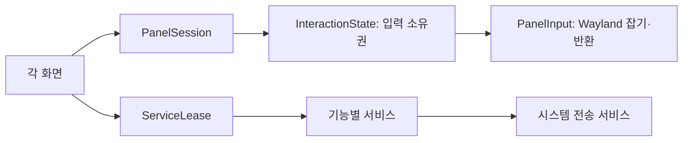

# 공통 동작 계약과 검증

이번 정리는 기능을 추가할 때 기존 패널들의 종료 목록을 고치는 구조를 없애고, 화면·서비스·시스템 명령의 경계를 분리한다. 기존 HUD 팔레트, native 벡터 버튼의 24px 슬롯/16px 그림, 창별 최대화 태그, TTY 자동 실행 및 설정 백업 정책은 유지한다.

## 입력과 패널

`core/InteractionModel.qml`은 현재 소유자·모니터·세대를 하나의 상태로 관리한다. 공개 상태는 읽기 전용이고 변경은 acquire/release/dismiss로 한다. 각 화면의 `PanelSession`이 등록되며 `PanelInput`만 Hyprland 입력 잡기와 Escape를 구현한다. 새 패널은 다른 패널 이름을 알 필요가 없다. 모니터 제거와 앵커 바깥 클릭도 같은 경로로 닫힌다.



바탕화면의 확인된 Kitty 수정은 유지한다. 잡기가 해제되면 `DesktopView`는 진행 중인 클릭 세대 전체를 폐기한다. 그 클릭의 지연된 press/release가 다시 입력을 잡을 수 없다. Dock hover 미리보기는 키보드를 잡지 않으며 다른 패널이 열려 있으면 대신 열리지 않는다. 앱 실행 완료로 패널을 닫을 때도 요청 당시 소유자와 세대가 여전히 같은지 확인한다.

## 창 명령과 실제 상태

셸의 `WindowCommands`와 별도 Files 프로세스의 `WindowClient`, native 버튼/단축키의 CLI는 모두 `window-service.py`를 사용한다. CLI를 상주 셸에 종속시키지 않아 Files와 제목 표시줄은 셸 패널이 닫혀 있어도 제어할 수 있다. 모든 프로세스는 같은 사용자 runtime 잠금을 사용한다.

응답 v1: `request`, `operation`, `target`, `ok`, `status`, `retryable`, `accepted`, `verified`, `state`. 관찰 상태에는 창 주소·위치·크기·모니터·floating/hidden/maximized/fullscreen/active만 포함하며 제목·파일 경로는 포함하지 않는다.

- `accepted`: 명령이 전달됐다.
- `verified`: 실제 Hyprland 상태가 기대한 결과와 일치한다. 최대화/스냅/복원은 요청한 geometry도 확인한다. 애니메이션을 고려해 최대 2초 동안 관찰한다.
- 창 닫기는 저장 확인창이 뜰 수 있어 `accepted=true, verified=false`가 정상일 수 있다. 앱을 강제로 죽이지 않는다.
- 결과 확인 실패는 `OutcomeUnknown`으로 보고한다. 실패가 곧 미적용이라는 뜻은 아니며 자동으로 토글이나 파일 변경을 재실행하지 않는다.
- `active`는 compositor의 활성 창이다. 키보드 입력 전달 성공은 별도 compositor 입력 테스트가 확인한다.

`WindowCatalog`는 관찰 상태와 최근 사용 순서만 관리한다. 패널 선택은 `WindowState`, 전송/대기는 `WindowClient`가 담당한다. 실패 안내는 입력을 받지 않는 `ActionFeedback`에서 보여 주므로 메뉴가 닫혀도 오류가 사라지지 않는다.

## 서비스와 비동기 요청

서비스에서 Control Center/Dashboard 페이지 이름을 확인하지 않는다. 화면이 `ServiceLease`로 사용 중임을 표시하고, `ConsumerSet`이 구독자를 관리한다. 마지막 화면이 닫혀도 실행 중인 요청이나 Bluetooth 인증은 완료/취소/타임아웃까지 전송 서비스를 유지한다. 화면을 닫는 것과 실제 장치 작업을 중단하는 것을 구분한다.

| 책임 | 코드 |
|---|---|
| 앱 목록·실행·즐겨찾기 | `ApplicationCatalog` |
| 앱과 실제 창 연결·활성화 | `ApplicationsState`, `core/ApplicationData.js` |
| 런처 검색/패널 | `LauncherState`, `LauncherModel` |
| MPRIS 재생과 미디어 패널 | `MediaState`, `MediaModel` |
| 시스템 helper 연결/수명 | `SystemBackend` |
| Bluetooth/밝기/전원/요약 통계/캡처 | `BluetoothState`, `BrightnessState`, `PowerState`, `SystemMetricsState`, `CaptureState` |
| 디렉터리 탐색/바탕화면 목록 | `Files`, `Desktop` Python 서비스 |
| 선택 검증과 GIO 파일 작업 | 조합해서 사용하는 `FileOperations` |

`RequestLedger`는 식별자와 success/failure/cancelled/timeout 상태를 제공한다. 최대 64개 요청을 유지하고 가장 가까운 deadline에만 타이머를 실행한다. 늦은 응답은 끝난 요청을 다시 완료하거나 새 요청의 busy를 해제하지 못한다. 앱 실행 15초, 파일 조회 15초, 파일 변경/창 명령 30초, Wi-Fi 연결 35초, Bluetooth 페어링 45초를 사용한다. 창 명령의 프로세스 간 잠금 대기는 15초로 제한한다. 사용자용 설명은 `ActionErrors.js`, 진단용 코드는 요청 결과에 둔다.

F5 새로고침은 앱/파일 서비스 재연결 및 조회에 사용한다. 파일 변경, 앱 실행, 최대화 토글을 자동 재시도하지 않는다. 타임아웃 후에는 실제 상태를 먼저 확인한다. Files는 서비스 재연결 시 기존 탭을 dirty로 표시하고 다음 열람 시 다시 조회한다. 비밀번호는 요청 원장이나 로그에 넣지 않는다.

## 디자인과 조작

`config/design-tokens.json`이 원본이다. `python3 scripts/design-tokens.py --write`로 다음 파일을 생성하며 직접 편집하지 않는다:

- `shell/ui/Theme.qml`
- `config/titlebars.lua`, `config/window-management.lua`
- `native/titlebars/design.hpp`
- `assets/gtk/hud.css`

Lua/CSS 레이아웃은 `config/templates/`에 있다. 기존 색·크기는 보존하고 Files의 별도 팔레트를 명명한 토큰으로 편입했다. 본문/보조 글자는 역할별 토큰을 쓰고 가장 작은 caption은 10px이다. 일반 버튼의 최소 입력 영역은 24px이며 작은 시각 요소는 입력 영역만 확장한다. Files 탭 닫기도 24px로 넓혔다. native와 Files의 창 제어 기호는 같은 폭/선 굵기 비율을 쓴다.

`ActionInput`이 FileButton/MediaButton/HudButton 및 상단 바 진입점의 Enter/Space, 접근성 이름, hover, 키보드 포커스, 설명을 공유한다. 우클릭 메뉴는 Menu 키/Shift+F10으로도 연다. 상단 바의 겹친 창 아이콘은 창 목록, Dock의 격자 아이콘은 앱 런처를 직접 연다. 기존 보조 우클릭 동선도 유지한다.

Control Center는 3열과 기준 폭에서의 원본 위치를 유지하고 트랙 폭만 조절한다. 전체 패널을 scale하지 않는다. Dashboard/Media는 작은 화면에서 원본 글자·버튼 크기를 유지한 스크롤 viewport를 사용한다. 따라서 작은 화면에서는 일부 내용을 스크롤해야 한다.

## 검증과 배포 상태

```bash
# 개발 검사: Python/GIO, QML 화면·입력 모델, native CPU 경로, 생성 토큰
bash scripts/check-code.sh
# 설치된 Qt/Quickshell 메타데이터로 전체 구문/import 검사
python3 scripts/lint-qml.py
# 별도 HOME/runtime/D-Bus/nested Hyprland에서 실제 입력 및 창 수명 검사
bash scripts/test-session.sh
# 위 검사와 같은 격리 세션 안에서 지원되는 native 소스 빌드·로드까지
bash scripts/test-session.sh --native
# 현재 데스크톱 읽기 전용 상태 검사
bash scripts/verify-runtime.sh
```

일반 설치 의존성은 추가하지 않는다. 개발 검사는 `qt6-declarative`, `gcc`, `pkgconf`, `cairo`가 필요하며 compositor 검사는 추가로 `wtype`, `wayland`, `wayland-protocols`, `dbus`가 필요하다. native 빌드는 기존 `hyprpm` 및 실행 버전과 일치하는 Hyprland 헤더가 필요하다. CI는 공식 Arch 컨테이너에 이 도구를 설치한다. `test-session.sh`는 프로토콜 XML 한 개를 공개 upstream의 고정 커밋에서 받아 임시 입력 도구를 컴파일한다. 기존 Wayland 세션 안에 테스트용 Hyprland 창을 열며, 입력은 그 자식 compositor에만 주입한다. LIBSEAT_BACKEND/SEATD_SOCK으로 실제 seat 획득을 차단하고 systemd 환경 가져오기/알림도 끈다. 자신이 실행한 프로세스만 정리한다. Wayland 부모 소켓이 없으면 TTY에서 새 세션을 시작하지 않고 거부한다.

CI는 `.github/workflows/checks.yml`에서 코드 검사 → import 메타데이터 검사 → 실제 설치 헤더에 대한 native 컴파일을 실행한다. GPU가 없는 hosted runner에서 compositor 검사를 통과한 것으로 처리하지 않는다. 실제 입력/런타임 import 검사는 위 스크립트로 노트북에서 실행하거나, Wayland 세션의 환경 변수를 가진 `self-hosted, linux, shittim-wayland` runner를 등록한 뒤 workflow_dispatch의 compositor 옵션으로 실행한다. 해당 runner는 신뢰한 코드의 명시적 실행에만 사용하며 PR에서 자동 실행하지 않는다. 아직 푸시되지 않은 로컬 변경의 CI가 통과했다고 간주하면 안 된다. GPU/실제 모니터 hotplug/물리 키보드·마우스 검사는 추가 확인해야 한다.

정적 lint는 모든 진단을 JSON으로 남긴다. 동적 var 모델/스타일 진단은 참고 정보이며 구문/import/required/alias/type 구성 실패를 차단한다. Quickshell 0.3.2가 `defaultAdapter`의 C++ 타입 이름을 namespace 없이 기록하는 한 가지 메타데이터 경고만 정확한 파일·메시지 조건으로 분리한다. 경고 자체는 보고서에 남고 실제 서비스 import 검사는 별도의 compositor 검사에 포함한다.

버전 기준과 native 지원 커밋은 `config/compatibility.json` 한 곳에서 읽는다. 일반 셸 최소 버전과 native 플러그인 커밋/ABI 지원은 서로 다른 검사다. `verify-runtime.sh`는 Git revision/dirty, 실행 계약·저장소 경로·소스 fingerprint, 설정 생성 결과, native 바이너리 hash/ABI/실제 로드 상태를 구분해서 보고한다. 조회만 수행하며 서비스를 재시작하거나 플러그인을 교체하지 않는다.

공식 동작 근거: [Hyprland 테스트 시작 코드](https://github.com/hyprwm/Hyprland/blob/v0.55.0/hyprtester/src/main.cpp), [세션 없는 nested 동작 및 systemd 환경 제어](https://github.com/hyprwm/Hyprland/blob/v0.55.0/src/Compositor.cpp), [libseat backend 선택](https://github.com/kennylevinsen/seatd), [Lua 테스트 설정](https://github.com/hyprwm/Hyprland/blob/v0.55.0/hyprtester/test.lua), [가상 포인터 프로토콜](https://github.com/hyprwm/Hyprland/blob/v0.55.0/protocols/wlr-virtual-pointer-unstable-v1.xml), [Arch wtype 패키지](https://archlinux.org/packages/extra/x86_64/wtype/).

## 기존 설치 업데이트

코드 전달 후 노트북에서 다음 순서로 적용한다. 이 단계는 셸 서비스를 다시 시작하며 열려 있던 패널과 세션 내 알림 기록이 초기화될 수 있다. Files는 파일 작업을 마친 뒤 창을 닫고 다시 연다.

```bash
cd ~/projects/shittim
git pull --ff-only
python3 scripts/design-tokens.py --check
bash scripts/setup-desktop-ux.sh
# 기존 Shittim native 제목 표시줄을 쓰는 경우에만 새 토큰/렌더러로 재빌드
bash scripts/setup-titlebars.sh --install-hyprbars
hyprctl reload
systemctl --user restart shittim.service
bash scripts/verify-runtime.sh
```

native 제목 표시줄을 설치하지 않은 환경에서는 해당 재빌드 줄을 건너뛴다. 새 렌더러가 필요하지만 현재 Hyprland가 지원 범위를 벗어나면 기존 바이너리를 강제로 로드하지 않는다.
