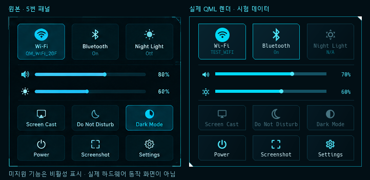

# Control Center

상단 바 오른쪽의 네트워크·배터리·시계 영역을 클릭하면 클릭한 모니터의 오른쪽 위에 열린다. 같은 영역을 다시 클릭하거나 바깥 영역 클릭, Escape로 닫는다. 볼륨 아이콘의 기존 좌클릭 음소거·5% 휠 조절은 유지하며 **우클릭**으로 패널을 연다. 모니터마다 바를 만들고 Control Center는 한 곳에만 표시한다.

개요 화면은 사용자가 지정한 원본 이미지의 **5번 패널**을 따른다. 원본에서 프레임을 337×293px로 측정했다. 상단은 Wi-Fi / Bluetooth / Night Light 3열, 중앙은 볼륨·밝기 한 줄씩, 하단은 Screen Cast / Do Not Disturb / Dark Mode와 Power / Screenshot / Settings의 3열×2행이다. 상단 타일은 92~93×70px, 하단은 92~93×49px이며 절단 모서리와 1px 프레임을 쓴다. 개요에는 별도 헤더·상태 카드·설명문을 넣지 않는다. 좁은 화면에서는 열 수를 바꾸지 않고 비율을 축소하며, 높이가 부족하면 스크롤한다.



오른쪽은 동일한 QML 화면을 Windows Qt에서 시험 데이터로 렌더링한 결과다. 실제 노트북 상태 또는 하드웨어 동작을 촬영한 화면이 아니다. 글꼴은 Hack Nerd Font Mono를 로드해 비교했다.

- Wi-Fi·Bluetooth 타일: 클릭하면 상세 화면, 우클릭하면 무선 전원 전환.
- 볼륨 아이콘: 클릭 음소거, 우클릭 오디오 상세. 밝기 아이콘: 밝기 상세.
- Power: 배터리·전원 프로필 상세. Settings: 모든 상세 화면과 실제 CPU·RAM·가동 시간.
- Screenshot: `grim`이 있으면 활성화. 패널을 숨기고 XDG 사진 디렉터리의 `Screenshots/shittim-날짜-시간.png`에 저장한다. 저장된 화면은 자동으로 Git에 추가하지 않는다.
- Night Light, Screen Cast, Do Not Disturb, Dark Mode 전환은 **미지원**이므로 비활성화하고 이유를 툴팁으로 표시한다. 현재 고정 HUD 테마를 시스템 테마 전환 기능으로 표시하지 않는다.

## 구현과 API

| 영역 | 실제 상태·제어 | 처리 |
| --- | --- | --- |
| 오디오 | [Quickshell PipeWire 0.3.2](https://quickshell.org/docs/v0.3.2/types/Quickshell.Services.Pipewire/Pipewire/) | 기본 sink를 한 곳에서 추적. 0~100% 제어, 음소거, 출력 장치 선택, 실제 재생 스트림별 볼륨. |
| Wi-Fi | [Networking](https://quickshell.org/docs/v0.3.2/types/Quickshell.Networking/Networking/), [WifiNetwork](https://quickshell.org/docs/v0.3.2/types/Quickshell.Networking/WifiNetwork/) | 장치 자동 탐색, 실제 SSID, 검색, 연결·해제. 저장된 인증을 먼저 시도하고 `NoSecrets`이면 WPA/WPA2 PSK·WPA3 SAE 비밀번호 입력. |
| 고급 Wi-Fi | [nm-connection-editor](https://archlinux.org/packages/extra/x86_64/nm-connection-editor/) | 기업용 802.1X·WEP·숨겨진 SSID는 시스템 연결 편집기로 설정. 단순 PSK 입력으로 처리하지 않는다. |
| Bluetooth | [Quickshell Bluetooth](https://quickshell.org/docs/v0.3.2/types/Quickshell.Bluetooth/), [BlueZ Agent1](https://bluez.readthedocs.io/en/latest/agent-api/) | 내장 모델로 어댑터·장치 추적과 전원·검색. 페어링·연결·해제는 인증 요청과 오류를 받을 수 있도록 같은 D-Bus 연결에서 처리. PIN·숫자 비교·원격 코드 표시·사용자 거부를 지원. 기본 에이전트를 가로채지 않는다. |
| 밝기 | [brightnessctl](https://github.com/Hummer12007/brightnessctl), [logind SetBrightness](https://www.freedesktop.org/software/systemd/man/latest/org.freedesktop.login1.html), `/sys/class/backlight` | 실제 장치 선택. 해제 시 적용, 최소 1%로 검은 화면 방지. 명령 실패 시 현재 UID의 활성 로컬 세션을 찾아 logind로 재시도한다. 둘 다 권한이 거부될 때 비활성화하며 상세 화면에서 새로고침할 수 있다. 외부 모니터 DDC/CI와 자동 밝기는 미지원. |
| 배터리·전원 | UPower, `org.freedesktop.UPower.PowerProfiles` | 기존 배터리 상태 공유. 전원 서비스가 노출한 프로필만 표시하며 성능 모드를 만들어내지 않는다. 0.3.2 PowerProfiles에는 서비스 가용성·실패 신호가 없으므로 보조 프로세스에서 비동기 D-Bus 결과를 확인한다. |
| 패널 | [HyprlandFocusGrab](https://quickshell.org/docs/v0.3.2/types/Quickshell.Hyprland/HyprlandFocusGrab/) + PanelWindow | 클릭한 화면, 화면 경계 제한, 외부 클릭·Escape, 화면 제거 시 닫기. |

`shell/services/`의 싱글턴을 바와 상세 화면이 공유한다. 기능별 상태는 실제 서비스의 QML 바인딩을 사용한다. `control-service.py`는 패널이 열린 동안만 실행하며, 밝기·선택적 전원 프로필·시스템 상태를 2초 간격으로 확인한다. 외부 Python 파일은 가상 QML URL이 아닌 `Quickshell.shellDir`의 실제 파일 경로로 실행한다. Bluetooth 검색은 45초 또는 패널 닫기 때 끝난다. 패널을 닫거나 재로드하면 인증 요청을 거부하고 진행 중인 페어링을 취소한다.

밝기 요청 처리 중에도 슬라이더는 활성 상태를 유지하고 마지막으로 선택한 값을 순서대로 적용한다. 명령 실패를 모두 권한 오류로 처리하지 않으며, 권한 거부·활성 세션 없음·명령 실패·응답 시간 초과를 구분한다. logind 재시도는 현재 사용자 소유의 활성 로컬 세션이 하나로 결정될 때만 사용하고 장치 권한이나 사용자 그룹을 변경하지 않는다.

Wi-Fi 비밀번호는 마스킹된 입력란에서 NetworkManager 내장 API로 직접 전달한다. 제출·취소·패널 닫기 때 입력란을 비운다. 명령 인자·환경 변수·로그·저장소 파일에 기록하지 않는다. NetworkManager 자체의 정상 인증 저장소에는 저장될 수 있다. 보조 프로세스도 stdin JSON을 평가하거나 원문을 로그에 출력하지 않는다.

## 패키지와 적용

기본 설치 목록에 `bluez`, `bluez-utils`, `python-dbus-next`, `nm-connection-editor`, `grim`을 추가했다. 기존 `brightnessctl`을 재사용한다. 모두 Arch 공식 Extra 저장소다. 기존 설치에서도 패키지 설치 단계만 다시 실행할 수 있다.

```bash
cd ~/projects/shittim
bash scripts/install-packages.sh
systemctl --user restart shittim.service
bash scripts/verify-control-center.sh
```

설정·자동 실행을 바꿀 필요 없이 새 패키지를 설치하고 셸만 다시 시작한다. BlueZ는 부팅 시 활성화하며 실행 중인 데스크톱·네트워크·오디오를 재시작하지 않는다. Bluetooth 하드웨어가 없으면 해당 컨트롤만 비활성화한다.

전원 프로필은 선택 사항이다. 기존 TLP·auto-cpufreq·tuned를 제거하거나 바꾸지 않는다. 별도 전원 관리자가 없는 환경에서 설치하려면:

```bash
./install.sh --with-power-profiles --dry-run
./install.sh --with-power-profiles
```

이 옵션은 `power-profiles-daemon`을 추가하며 충돌하는 전원 관리 패키지가 이미 있으면 설치 전에 중단한다. 옵션이 없어도 이미 호환 서비스가 실행 중이면 패널에서 사용할 수 있다.

## 검증

`verify-control-center.sh`는 Bash 문법·Python 테스트·Qt 화면 테스트를 실행하고, 마지막으로 **실제 Quickshell**에서 모든 컴포넌트를 숨긴 채 생성해 import 검사를 한다. 검증 진입점 `shell/verify-control-center.qml`은 실제 `shell.qml`과 같은 설정 루트를 사용한다. Quickshell 0.3.2는 이 루트 밖으로 향하는 상대 import를 차단하므로 진입점을 `shell/tests/` 아래로 옮기지 않는다. 두 번째 바를 표시하지 않고 같은 경로의 보조 프로그램을 실행해 준비·상태 응답과 백라이트 장치 수를 확인한 뒤 종료한다. 12초 안에 응답이 없거나 먼저 종료되면 검사 실패다. 실제 Hyprland의 Kitty에서 실행한다. 코드 검사에서 시스템 설정을 변경하지 않는다.

실기에서는 다음을 확인한다.

1. 패널 열기·닫기, 반복 클릭, 바깥 클릭·Escape, 다른 모니터에서 열기, 화면 제거, 작은 화면·배율.
2. 볼륨 슬라이더·음소거와 바의 휠·좌클릭 유지. `wpctl set-volume @DEFAULT_AUDIO_SINK@ 35%`로 외부 변경 동기화. 출력 장치 변경·제거 및 앱별 볼륨.
3. 한글·공백·특수문자 SSID, 저장된 연결, PSK 신규 연결·틀린 비밀번호·취소, Wi-Fi 끄기·켜기·하드웨어 차단, 유선 동시 연결. `nmcli -f IN-USE,SSID,SIGNAL device wifi list --rescan no`와 비교.
4. Bluetooth 검색, PIN·숫자 비교, 페어링 취소, 연결·해제, 어댑터 끄기·제거. `bluetoothctl show`·`bluetoothctl devices`와 비교.
5. 밝기 장치 변경·외부 단축키 동기화·권한 거부·장치 없는 환경. `brightnessctl --class=backlight --machine-readable info`와 비교.
6. 배터리 상태, 지원되는 전원 프로필 변경, 전원 서비스 없는 환경, Screenshot 저장 위치.

Windows Qt 화면 테스트는 화면·입력·바인딩만 확인한다. Arch WSL 테스트는 파일 작업·명령 검증·인증 프로토콜만 확인한다. 실제 Quickshell 실행, NetworkManager 연결, BlueZ 페어링, 화면 포커스·백라이트·전원 제어는 노트북에서 확인해야 한다. 로컬 Qt 6.9 lint는 Arch의 더 새로운 Qt가 생성한 타입 메타데이터를 완전히 해석하지 못하므로 실제 Quickshell import 검사를 별도로 제공한다.

## 변경 파일

- 진입점·바 연결: `shell/shell.qml`, `shell/components/TopBar.qml`, `Network.qml`, `Volume.qml`, `Battery.qml`, 신규 `ControlCenter.qml`.
- 공통 상태: 신규 `shell/services/qmldir`, `AudioState.qml`, `NetworkState.qml`, `BatteryState.qml`, `ControlState.qml`, `SystemControl.qml`.
- 패널·상세 화면: 신규 `shell/components/control/ControlFrame.qml`, `QuickTile.qml`, `ControlOverview.qml`, `ControlContent.qml`, `LevelControl.qml`, `WifiPage.qml`, `BluetoothPage.qml`, `AudioPage.qml`, `BrightnessPage.qml`, `PowerPage.qml`, `SettingsPage.qml`.
- 공통 UI: 신규 `shell/ui/HudSlider.qml`, `HudInput.qml`, 토큰·등록 수정 `Theme.qml`, `qmldir`.
- 보조 서비스·설치: 신규 `scripts/control-service.py`, `scripts/verify-control-center.sh`, 수정 `install.sh`, `scripts/common.sh`, `install-packages.sh`, `packages.txt`, `verify.sh`.
- 검사·문서: 신규 `shell/tests/tst_control.qml`, `shell/verify-control-center.qml`, `tests/test_control_service.py`, `tests/test_qml_imports.py`, `docs/control-center.md`, `docs/control-center-comparison.png`, 수정 `README.md`.
