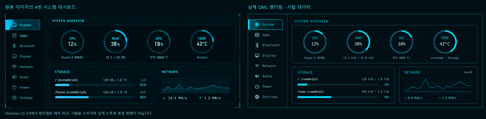

# System Dashboard

상단 바의 **SHITTIM 로고**로 열고 닫는다. 클릭한 바의 모니터 왼쪽 상단, 바 아래에서 열린다. Escape·바깥 클릭·바의 다른 영역 클릭·다른 Shittim 패널 열기로 닫힌다. 패널은 한 개이며 화면 크기와 배율에 따라 축소한다.



왼쪽은 제공된 1536×1024 이미지의 `(25,702)–(771,1002)` 영역, 오른쪽은 실제 QML을 Windows Qt 6.9에서 렌더링한 화면이다. **비교용 수치는 저장소 밖의 시험 데이터이며 노트북 측정값이 아니다.** 실행 중인 화면은 아래 실제 수집기만 사용한다.

원본 좌표를 기준으로 746×300px 패널·125px 사이드바·4개 원형 계기판·Storage/Network 2열을 유지한다. 각 계기판은 76px 원, 5px 진행선, 하단 실제 장치/센서 정보로 구성한다. 326×118px Storage와 249×118px Network를 하단에 배치한다. 일반적인 둥근 카드·추가 헤더·그림자·반복 발광 효과를 넣지 않았다.

## 실제 데이터와 지원 범위

| 항목 | 실제 데이터 | 계산·표시 정책 |
|---|---|---|
| CPU | `/proc/stat`, `/proc/cpuinfo` | 첫 8개 CPU 누적 카운터의 차이. idle+iowait 제외, 이미 user/nice에 포함된 guest 카운터를 다시 더하지 않음. 첫 표본·카운터 초기화는 N/A |
| RAM | `/proc/meminfo` | `MemTotal−MemAvailable` 사용량 및 사용률. 읽지 못한 값을 0으로 대체하지 않음 |
| GPU | DRM `card*/device/gpu_busy_percent`, 선택적으로 NVIDIA `nvidia-smi` | 지원되는 sysfs busy 값 우선. NVIDIA 장치와 명령이 모두 있을 때 읽기 전용 CSV 쿼리. 미지원·권한 부족·도구 실패는 N/A |
| TEMP | hwmon `temp*_input`, thermal zone `temp` | 밀리섭씨를 섭씨로 변환. CPU 계열 hwmon 우선, 없으면 CPU thermal zone·다른 실제 센서 순. 같은 우선순위에서 최고 온도를 선택하고 정확한 센서 이름 표시 |
| Storage | `/proc/self/mountinfo`, `statvfs` | 로컬 마운트의 실제 사용량·전체 용량. 사용률은 예약 블록을 제외하는 df 방식. 마운트 지점별 표시, 공백/한글 경로 처리 |
| Network | `/proc/net/dev`, IPv4/IPv6 기본 경로, sysfs 인터페이스 상태 | 인터페이스별 RX/TX 바이트 차이 ÷ monotonic 시간 차이. loopback/P2P 제외, ifindex 변경·카운터 초기화는 N/A |

GPU는 첫 번째 **사용률을 제공하는** 장치를 선택하며, 같은 조건이면 `boot_vga` 장치를 우선한다. AMD `amdgpu`의 표준 busy 파일을 지원한다. Intel i915 등 해당 파일을 제공하지 않는 드라이버는 사용률을 임의 계산하지 않고 N/A로 표시한다. NVIDIA 쿼리는 2초 캐시, 0.8초 타임아웃이며 셸 문자열 실행을 사용하지 않는다. NVIDIA 도구가 설치되지 않았거나 해당 하드웨어가 없으면 실행하지 않는다.

온도 계기판은 표시 범위 0–100°C로 진행률을 그린다. 실제 온도 값은 별도로 표시한다. 드라이버가 `temp*_crit` 또는 critical thermal trip을 제공할 때만 그 임계값으로 경고색을 결정한다. 센서 fault/disable 값과 명백하게 잘못된 읽기값은 제외한다. 특정 센서를 CPU 온도인 것처럼 이름을 바꾸거나 `Normal` 같은 예시 상태를 하드코딩하지 않는다.

Storage는 ext4/btrfs/xfs/vfat/exfat/ntfs 계열 등 로컬 파일시스템과 루트 overlay를 대상으로 한다. proc/sysfs/tmpfs와 NFS/CIFS 등 원격 파일시스템은 제외한다. 파일 단위 bind mount는 표시하지 않는다. 여러 btrfs 서브볼륨이 같은 용량을 공유할 수 있으며, 각 마운트 행의 용량을 합산하지 않는다. 마운트는 최대 64개, 화면에서는 스크롤해 확인한다. 바이트 단위는 KiB/MiB/GiB/TiB다.

Network는 유효한 IPv4 기본 경로를 우선하고, 없으면 IPv6 기본 경로의 인터페이스를 선택한다. 각 주소 계열 안에서는 낮은 metric 우선이며, 연결된 물리 인터페이스를 마지막 대안으로 사용한다. VPN의 기본 경로가 선택되면 그 인터페이스의 값이다. 그래프는 최신 60개 실제 표본의 다운로드·업로드를 그린다. 인터페이스가 바뀌면 그래프를 비우고, 누락·초기화 구간을 0으로 연결하지 않는다.

## 측정 수명과 자원 사용

- `System` 화면이 보일 때만 `dashboard-service.py` 프로세스를 실행한다. 다른 사이드바 메뉴로 이동하거나 닫으면 종료한다. 다시 열면 누적 카운터 기준점을 새로 잡는다.
- CPU/RAM/Network/TEMP는 약 1초 간격, GPU는 2초 캐시, Storage는 15초 간격이다. 측정 간격이 흔들려도 네트워크 속도 계산은 실제 monotonic 경과 시간을 사용한다.
- Storage의 느린 읽기는 단일 백그라운드 작업으로 분리하여 CPU·네트워크 표본을 막지 않으며 같은 작업을 겹쳐 쌓지 않는다. 읽기 작업은 해당 수집기 프로세스 안에 있다.
- `/proc`·`/sys`에 쓰거나 sudo를 호출하지 않는다. 알림·비밀번호·IP·MAC·프로세스 목록·파일 내용은 수집하지 않는다. 자동 로그 파일·데이터 영속 저장도 만들지 않는다.
- 그래프 기록은 60개, 수집 프로세스는 한 개다. 측정 실패 시 N/A와 오류를 표시하며 이전 값을 현재 측정값처럼 계속 표시하지 않는다.

## 사이드바

| 메뉴 | 동작 |
|---|---|
| System | 4개 계기판·Storage·Network 실시간 화면 |
| Apps | 기존 GIO 앱 목록·검색·실행 로직과 런처 화면 재사용. 앱 실행 성공 시 대시보드 닫기 |
| Bluetooth | 기존 어댑터·검색·페어링·연결/해제 화면과 서비스 재사용 |
| Display | 기존 백라이트 선택·밝기 제어. 모니터 배치·해상도 편집을 지원하는 것처럼 표시하지 않음 |
| Network | 기존 NetworkManager Wi-Fi 목록·검색·연결·인증·네트워크 편집기 재사용 |
| Audio | 기존 PipeWire 출력 장치·볼륨·음소거·앱별 볼륨 재사용 |
| Power | 기존 배터리·전원 프로필 재사용. 미지원 기능은 비활성화 |
| Settings | 기존 시스템 세부 설정 진입과 CPU/RAM/uptime 정보 |

`SystemBackend`는 화면의 `ServiceLease` 구독과 진행 중인 요청이 있을 때 실행한다. Wi-Fi 검색도 구독이 있는 동안만 켠다. 상세 화면은 `ControlContent`를 헤더 없이 포함하고 기능별 서비스를 재사용한다. 별도의 중복 Bluetooth 에이전트나 네트워크 관리 서비스를 만들지 않았다. 책임 분리 및 실행 검사는 [공통 동작 계약](architecture.md)을 따른다.

Control Center·App Launcher·Notification Center와 대시보드는 서로 닫힘 상태를 연결했다. 알림 기록은 계속 수신하고, 기존 정책과 같이 다른 셸 패널이 열린 동안 팝업을 겹쳐 표시하지 않는다.

## 적용과 검증

추가 필수 패키지는 없다. 기존 설치의 Python 표준 라이브러리, Qt/Quickshell과 기존 제어 서비스 의존성을 사용한다. NVIDIA의 선택적 `nvidia-smi`를 위해 드라이버나 `nvidia-utils`를 임의 설치하지 않는다.

변경이 원격에 푸시된 뒤 노트북의 Kitty에서 실행한다.

```bash
cd ~/projects/shittim
git pull --ff-only
systemctl --user restart shittim.service
bash scripts/verify-dashboard.sh
```

검증 스크립트는 Bash 문법·수집기 테스트·실제 Linux 표본·선택적 Qt 화면 테스트·실행 중인 Shittim IPC를 확인한다. 대시보드가 닫혀 있으면 잠시 열어 2개 이상의 측정 응답을 확인하고 다시 닫아 **실제 PID와 실행 상태가 사라졌는지 검사**한다. 이미 System 화면이 열려 있으면 유지하고, 상세 화면을 보고 있으면 그 화면을 강제로 바꾸지 않는다. 다른 셸 패널은 다시 열어야 할 수 있다. 별도 Quickshell 인스턴스를 띄우지 않는다.

```bash
# 현재 화면을 바꾸지 않는 상태 조회
bash scripts/dashboard.sh status
# 단일 실제 표본 출력. 저장하거나 Git에 추가하지 않는다.
python3 scripts/dashboard-service.py --once
# 그래픽 UI를 조작하지 않는 코드 점검
bash scripts/verify-dashboard.sh --dry-run
```

노트북에서 다음을 확인한다.

1. SHITTIM 로고로 열기/닫기, Escape·바깥 클릭, 다른 세 패널과 번갈아 열기.
2. 첫 누적 표본은 N/A, 다음 표본부터 CPU·네트워크 갱신. 기존 도구의 측정 구간 차이를 감안하여 `top`, `free -b`, `df -B1`, 필요하면 `nvidia-smi`와 비교.
3. 실제 GPU 드라이버와 센서의 지원 여부·이름·값. 미지원 Intel GPU나 센서가 없는 환경에서 N/A 표시.
4. 파일 복사/다운로드 시 속도와 그래프, 네트워크 전환·해제·재연결 시 새 기준점과 그래프 초기화.
5. 마운트 추가/해제·긴 경로·저장장치 목록 스크롤. OS의 지원 로컬 파일시스템만 표시되는지 확인.
6. Apps 검색/실행과 나머지 사이드바 제어. Wi-Fi 인증·Bluetooth 페어링·밝기 변경 등은 실제 장치에서 확인.
7. 다른 모니터의 로고 클릭, 다른 배율·작은 화면·모니터 제거. 각 계기판과 하단 두 열의 배치를 유지하면서 화면 안에 들어오는지 확인.
8. 닫은 뒤 `dashboard.sh status`에서 `measuring:false`, `process:false`, `pid:0`. 기존 바·워크스페이스·알림·런처·Control Center 회귀 없음.

Windows에서는 실제 QML 화면 렌더링·화면/모델 테스트·구문·로컬 import를 확인했다. Arch WSL에서는 읽기 전용 실제 `/proc` 표본과 프로세스 종료, 가상 파일로 CPU/메모리/네트워크/마운트/센서/드라이버별 오류 처리를 확인했다. **노트북의 실제 GPU·온도 센서·Hyprland 창/포커스·다중 모니터·실제 시스템 제어를 이 환경에서 검증했다고 주장하지 않는다.**

## 변경 파일

신규:

- `shell/components/SystemDashboard.qml`
- `shell/components/dashboard/{DashboardView.qml,SystemOverview.qml,DashboardGauge.qml,NetworkGraph.qml,DashboardModel.qml,Format.js}`
- `shell/services/DashboardState.qml`, `shell/tests/tst_dashboard.qml`
- `scripts/{dashboard-service.py,dashboard.sh,test-dashboard.py,verify-dashboard.sh}`
- `tests/test_dashboard_service.py`, `docs/dashboard.md`, `docs/dashboard-comparison.png`

수정:

- `shell/{shell.qml,ui/Theme.qml,services/qmldir}`
- `shell/components/{TopBar.qml,NotificationPopups.qml,control/ControlContent.qml}`
- `shell/services/{SystemControl.qml,NetworkState.qml,LauncherState.qml}`
- `shell/tests/tst_control.qml`, `README.md`

API 근거: [Quickshell 0.3.2 Process](https://quickshell.org/docs/v0.3.2/types/Quickshell.Io/Process/), [Linux procfs](https://docs.kernel.org/filesystems/proc.html), [네트워크 통계](https://docs.kernel.org/networking/statistics.html), [hwmon](https://docs.kernel.org/hwmon/sysfs-interface.html), [AMD GPU 계측](https://docs.kernel.org/gpu/amdgpu/thermal.html), [NVIDIA SMI](https://docs.nvidia.com/deploy/nvidia-smi/index.html). 기존 Quickshell 0.3.2 소스·QML 타입 메타데이터와 기존 동작 중인 패널의 Wayland/Hyprland API 패턴을 함께 확인했다.
