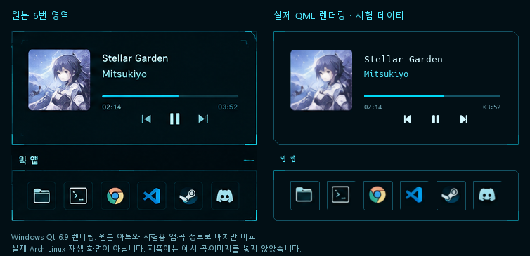

# App / Media Controls

상단 바의 음악 아이콘을 누르면 현재 클릭한 모니터의 오른쪽 하단에 연다. 다시 누르거나 Escape·패널 바깥을 클릭하면 닫힌다. 기존 Shittim 프로세스에 창 하나만 만들며, Control Center·Notification Center·App Launcher·System Dashboard와 동시에 열리지 않는다. 다른 패널의 디자인과 자동 실행 설정은 유지한다.

## 디자인

원본 1536×1024 이미지의 6번 영역 `(1161,711)–(1510,982)`를 기준으로 349×271 비율을 사용한다.

| 요소 | 좌표 및 크기 |
|---|---|
| 미디어 프레임 | 0,0 / 349×163 |
| 앨범 아트 | 24,27 / 88×88 |
| 제목·아티스트 | x=129 / y=29,51 / 폭 194 |
| 진행률 | 129,85 / 194×16 안의 3px 선 |
| 재생 시간 | y=100, 좌우 정렬 |
| 이전·재생·다음 | x=176,216,256 / y=112 |
| 웹 앱 제목 | 10,171 |
| 앱 프레임 | 0,199 / 349×72 |
| 앱 버튼 | 42×42, 간격 10, 좌우 24 여백 |

기존 Theme·HudText·HudIcon·HudSlider·ControlFrame을 재사용한다. MediaFrame은 원본의 짧은 모서리 강조선을 더한다. 작은 화면에서는 전체 비율을 유지해 축소한다. 앱이 6개보다 많으면 프레임 안에서 가로로 스크롤한다.



비교 그림의 오른쪽은 Windows Qt 6.9에서 **실제 MediaView를 시험 데이터로 렌더링한 화면**이다. 원본에서 자른 아트·아이콘과 시험용 곡·앱을 사용해 배치를 비교했다. 이 시험 자산은 제품 소스에 넣지 않았다. 실제 Arch 재생 화면이라고 간주하지 않는다.

원본과 달라지는 부분은 실제 설치된 앱의 아이콘·개수, 플레이어가 제공하는 텍스트·이미지·제어 가능 여부, 시스템 글꼴이다. 원본의 커스텀 음악 버튼은 기존 Nerd Font 아이콘으로 표현한다. 실패 메시지는 필요한 동안에만 작은 섹션 제목 옆에 표시한다. 미디어가 없으면 가짜 아트 대신 음악 아이콘과 `NO ACTIVE MEDIA`를 표시한다.

## 미디어

Quickshell 0.3.2의 `Quickshell.Services.Mpris`를 사용한다. 별도의 playerctl 폴링 프로세스나 MPRIS 서버를 만들지 않는다.

- `Mpris.players.values`의 실행 중인 플레이어를 자동 탐색한다. 자동 선택은 재생 중인 플레이어 우선, 다음으로 서비스가 제공하는 목록 순서다.
- 제목·아티스트·아트·재생 상태·곡 길이·현재 위치를 실제 `MprisPlayer`에서 읽는다. 곡 교체·프로세스 종료·새 플레이어 등장은 바인딩으로 반영한다.
- 여러 플레이어가 있으면 **앨범 아트 또는 곡 제목·아티스트 영역을 클릭**해 목록 순서대로 전환한다. 툴팁에 현재 플레이어 이름을 표시한다. 직접 선택은 해당 플레이어가 종료될 때까지 유지하고, 종료되면 자동 선택으로 돌아간다.
- 이전·재생/일시정지·다음은 `canControl`, `canGoPrevious`, `canTogglePlaying`, `canGoNext`가 허용할 때만 호출한다.
- Seek는 `canSeek`, `positionSupported`, `lengthSupported` 및 양의 곡 길이가 있을 때만 허용한다. 드래그 동안 미리 보고 놓을 때 0~곡 길이로 제한해 한 번 전달한다. 드래그 도중 플레이어·곡이 바뀌거나 패널을 닫으면 전달하지 않는다. 같은 D-Bus 이름으로 재시작된 다른 플레이어 객체에도 이전 Seek를 전달하지 않는다.
- 재생 중이고 패널이 열려 있을 때만 250ms 타이머가 `positionChanged()`를 발생시킨다. Quickshell이 계산하는 위치를 다시 읽으며 외부 명령이나 D-Bus 주기 질의를 만들지 않는다. 일시정지·닫힘 상태에서는 타이머가 멈춘다.
- 길이·위치가 제공되지 않으면 `--:--`, 진행률과 Seek는 비활성화한다. 읽기만 가능한 진행률은 그대로 표시하고 제어만 비활성화한다.
- 외부 문자열은 길이를 제한하고 PlainText로 출력한다. 아트는 로컬 `file:///` 또는 `file://localhost/`, 자격 증명이 없는 HTTP(S) URL만 허용한다. `data:`, `qrc:`, 이미지 프로바이더·원격 file 호스트는 거부한다. 이미지 읽기 실패는 기본 음악 아이콘으로 처리한다. 웹 아트는 해당 서버에 이미지 요청을 보낸다. 패널이 닫혀 있으면 아트를 읽지 않는다.
- 곡·아트·재생 이력은 파일이나 Git에 저장하지 않는다. 내장 MPRIS API는 모든 플레이어의 원격 제어 실패를 별도 QML 오류 신호로 제공하지 않으므로, 실제 상태 변경은 플레이어의 이벤트를 따른다.

## 즐겨찾기

저장소 기본값은 `config/dock.json`이다. 파일 관리자·Kitty·Chrome·Code·Steam·Discord의 Desktop Entry ID를 우선순위대로 지정했으며 **실제 GIO 목록에 있는 앱만** 표시한다. 이 앱들을 추가 설치하거나 존재하지 않는 바로가기를 표시하지 않는다.

개인 설정은 `$XDG_CONFIG_HOME/shittim/dock.json`, 기본값은 `~/.config/shittim/dock.json`이다. 개인 파일이 있으면 기본 파일 전체를 대체한다. 설치 프로그램은 개인 파일을 생성·덮어쓰기·수집하지 않는다. 빈 `favorites`는 의도적인 빈 목록이다. 잘못된 설정은 기본값으로 몰래 되돌리지 않고 앱 바를 비우고 오류를 표시한다.

개인 설정 만들기:

```bash
cd ~/projects/shittim
mkdir -p ~/.config/shittim
test -e ~/.config/shittim/dock.json || cp config/dock.json ~/.config/shittim/dock.json
```

`~/.config/shittim/dock.json`을 평소 쓰는 텍스트 편집기로 수정한다. 파일 내용 예시:

```json
{
  "favorites": ["kitty.desktop", "org.kde.dolphin.desktop", "code.desktop"],
  "windowClasses": {
    "code.desktop": ["Code", "code"]
  }
}
```

`favorites`에는 앱 표시 이름이나 Exec 문자열 대신 `.desktop` ID를 쓴다. 최대 64개이며 중복은 제거한다. 개인 파일이 저장되거나 원자적으로 교체되면 기존 GIO 서비스의 파일 감시로 갱신한다. 파일 감시가 없는 파일시스템에서는 패널에서 F5 또는 `bash scripts/media.sh reload`로 갱신한다. 파일 삭제 시 저장소 기본 설정으로 돌아간다.

## 앱 실행·창 활성화

App Launcher의 동일한 `LauncherState`·GIO 카탈로그·아이콘 탐색·비동기 실행을 공유한다. 중복 XDG 스캐너나 실행 프로세스를 만들지 않는다. GIO가 `.desktop`의 인수·필드 코드·작업 디렉터리·터미널 실행을 처리한다. 제거·숨김 여부를 실행 직전에 다시 검사하며 오류 텍스트에 Exec 인수를 노출하지 않는다.

Quickshell의 Hyprland IPC 모델 `Hyprland.toplevels`로 창 상태를 읽고 `window.wayland.activate()`로 요청한다. Lua dispatcher 문자열을 만들어 실행하지 않으므로 기존 `hyprland.lua` 설정을 수정하지 않는다.

창 매칭은 대소문자까지 동일한 Desktop Entry ID의 `.desktop` 제거값 또는 GIO `StartupWMClass`와 창의 Wayland app ID·Hyprland class·initialClass를 비교한다. `windowClasses`가 지정된 앱은 그 값만 사용한다. 제목·실행 파일·부분 문자열로 유추하지 않는다. 같은 식별자를 여러 설치 앱이 공유하면 해당 식별자로는 창을 선택하지 않는다. 다른 앱을 잘못 선택하는 대신 GIO로 앱을 실행한다.

여러 창은 현재 활성 창 → Shittim이 관찰한 최근 활성 순서 → 주소의 안정적인 정렬 순서로 선택한다. 패널을 열 때 IPC 정보를 한 번 새로 읽고 이후에는 이벤트를 따른다. 기존 창이 있으면 패널의 포커스 잡기를 해제한 다음 활성화한다. 창이 사라졌거나 Wayland 핸들이 없으면 오류로 처리한다. 진행 중인 앱 실행은 중복 요청하지 않는다. 실행 중 표시는 같은 확실한 창 매칭 결과에만 표시한다.

창 활성화 요청은 compositor 정책에 따라 거부될 수 있다. 다른 워크스페이스 활성화, 최소화·특수 워크스페이스·XWayland 앱 및 자체 커스텀 class는 실제 Hyprland에서 확인해야 한다. 필요하면 `hyprctl clients -j`의 `class`/`initialClass`를 보고 개인 `windowClasses`에 정확한 값을 지정한다.

## Arch Linux 검사

기존 설치에는 새 필수 패키지가 없다. `quickshell`, `python`, `python-gobject`, `python-dbus-next`, `xdg-terminal-exec`와 아이콘·글꼴은 이미 `scripts/packages.txt`에 포함되어 있다. native MPRIS 모듈을 사용하므로 playerctl을 새로 호출하지 않는다.

```bash
cd ~/projects/shittim
systemctl --user restart shittim.service
bash scripts/verify-media.sh
bash scripts/media.sh show
```

`verify-media.sh --dry-run`은 Bash·Python·QML import·설정 및 기존 런처 회귀 검사를 수행한다. qmltestrunner가 있으면 전체 QML 단위 검사도 실행한다. 실제 모드의 `test-media.py`는 세션 D-Bus의 MPRIS 서비스 수와 현재 Shittim IPC 상태만 읽는다. 사용자의 곡·재생 상태·선택 플레이어를 변경하거나 제목·URI를 출력하지 않는다. 이 검사를 통과했다고 재생 제어까지 검증한 것으로 간주하지 않는다.

실제 세션에서 확인:

1. Spotify·브라우저 등 MPRIS 지원 앱에서 음악을 재생한다. 음악 아이콘 → 제목·아트·현재 시간·길이가 일치하는지 본다.
2. 일시정지·재생·이전·다음·진행 막대 클릭과 드래그를 확인한다. 플레이어가 지원하지 않는 버튼은 비활성화되어야 한다.
3. 플레이어 둘을 실행하고 제목 영역을 눌러 전환한다. 선택 플레이어를 종료하면 남은 플레이어로 전환되어야 한다. 모두 종료하면 빈 상태가 보여야 한다.
4. 실제 설치된 즐겨찾기를 실행한 후 다른 워크스페이스로 이동하고 같은 앱을 누른다. 기존 창이 활성화되는지, 실행 중 표시가 맞는지 확인한다.
5. 개인 설정에 없는 앱 ID·빈 목록·수정·삭제·잘못된 JSON을 각각 시험한다. 기존 App Launcher의 검색·실행·터미널 앱도 확인한다.
6. 패널 열기/닫기·Escape·외부 클릭·모니터 전환·배율과 작은 해상도를 확인한다. 다른 패널이 동시에 열리지 않아야 한다.

IPC 명령은 `bash scripts/media.sh [toggle|show|hide|status|reload]`다. 별도 Quickshell 인스턴스를 만들지 않는다. 기본 단축키는 추가하지 않는다.

## 변경 파일

- 신규: `config/dock.json`, `scripts/{dock-settings.py,media.sh,verify-media.sh,test-media.py}`
- 신규: `shell/components/AppMediaControls.qml`, `shell/services/MediaState.qml`
- 신규: `shell/components/media/{MediaData.js,MediaModel.qml,MediaFrame.qml,MediaButton.qml,MediaView.qml}`
- 신규: `shell/tests/tst_media.qml`, `tests/test_media_settings.py`, `docs/{media-controls.md,media-comparison.png}`
- 수정: `scripts/launcher-service.py`, `shell/services/LauncherState.qml`, `shell/components/{TopBar.qml,NotificationPopups.qml}`
- 수정: `shell/{shell.qml,services/qmldir,ui/Theme.qml}`, `tests/test_launcher_gio.py`, `README.md`

Windows에서는 실제 QML 렌더링·모델·마우스/키보드·Seek 경계·플레이어 전환·창 매칭을 시험 데이터로 검사한다. Arch WSL에서는 실제 GIO 앱 탐색·실행과 개인 설정의 파일 생성·교체·변경·삭제를 격리된 임시 경로에서 검사한다. 실제 노트북 MPRIS·Hyprland 창 포커스·다중 모니터·장치별 UI는 여기서 실행 검증하지 않았다.

작성 후 QML 단위 검사 81개, Arch WSL Python 검사 71개가 통과했다. 전체 Bash 문법, Python AST, QML 구문 파싱, 로컬 import 경계도 확인했다. Windows의 qmllint와 공식 Linux 타입 메타데이터 조합에서는 동적 `ObjectModel.values`·PanelWindow·Margins·Screen을 완전히 해석하지 못하는 경고가 남는다. 이 부분은 실제 0.3.2 소스 및 기존 사용 패턴과 대조했고, 실제 Quickshell/Wayland 로딩 검증을 대체하지 않는다.

API: [MprisPlayer 0.3.2](https://quickshell.org/docs/v0.3.2/types/Quickshell.Services.Mpris/MprisPlayer/), [HyprlandToplevel 0.3.2](https://quickshell.org/docs/v0.3.2/types/Quickshell.Hyprland/HyprlandToplevel/), [Wayland Toplevel 0.3.2](https://quickshell.org/docs/v0.3.2/types/Quickshell.Wayland/Toplevel/). 소스와 공식 타입 메타데이터를 함께 확인했다.
