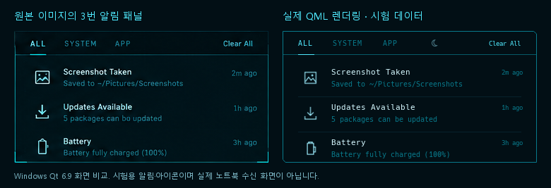

# 알림 센터

상단 바의 종 아이콘을 누르면 해당 모니터 오른쪽 상단에서 열린다. 바깥 클릭·Escape·다른 Shittim 패널 열기로 닫힌다. 기존 시스템 상태 영역은 Control Center를 계속 연다.



왼쪽은 제공된 1536×1024 이미지의 `(1150,473)–(1510,660)` 영역이다. 오른쪽은 실제 `NotificationView.qml`을 Windows Qt 6.9에서 렌더링한 화면이다. 비교용 알림·아이콘은 저장소 밖의 시험 데이터이며, 실제 노트북에서 수신한 화면이 아니다. 패널 360×187px, 검색창 없는 34px 탭 줄, 50px 알림 행, 21px 아이콘, 11px 제목·10px 본문을 사용한다. 작은 화면에서는 폭을 줄여 같은 배치를 축소하고 목록을 스크롤한다.

## 알림 처리

- 프로세스당 하나의 `Quickshell.Services.Notifications.NotificationServer`가 `org.freedesktop.Notifications`를 소유한다. 별도 알림 데몬이나 알림 내용 수집 프로세스를 실행하지 않는다.
- 제목·본문·앱 이름·desktop entry·아이콘·중요도·액션을 실제 알림에서 읽는다. 같은 ID는 하나의 항목으로 갱신한다. 0.3.2는 교체 시 서버의 `notification()` 신호를 다시 보내지 않으므로, 기존 객체의 속성 변경을 추적한다.
- 제목을 누르면 본문·앱 이름·도착 시각·지원되는 이미지와 액션을 펼친다. 팝업 본문 클릭은 `default` 액션이 있으면 실행하고, 없으면 센터의 해당 알림을 연다. 액션은 현재 살아 있는 알림의 최신 `NotificationAction.invoke()`로 전달한다. 닫히거나 만료된 알림의 액션은 제거한다. `resident` 알림은 API의 기본 동작에 따라 액션 실행 후에도 유지한다.
- 팝업은 한 화면에 최대 3개를 표시하며 긴급 알림이 우선한다. 새 팝업 묶음은 현재 포커스된 모니터에 고정한다. 모니터가 제거되면 남은 화면으로 옮긴다. 바 아래 48px부터 표시하고 다른 Shittim 패널이 열려 있으면 겹쳐 표시하지 않는다.
- 서버 기본 만료 시간은 일반 알림 6초, 긴급 알림은 무기한이다. 앱이 지정한 `0`은 무기한, 양수는 밀리초 단위로 적용하며 상한은 24시간이다. 0.3.2 소스에서 `expireTimeout`은 밀리초 값을 그대로 제공한다. 헤더의 초 단위 설명과 구별하여 구현했다. 가장 가까운 만료 시각에만 타이머를 실행한다.
- 자동 만료는 `expire()`로 종료 이유 1, 팝업 닫기·기록 삭제·전체 삭제·용량 초과는 `dismiss()`로 이유 2를 전송한다. 팝업을 닫아도 텍스트 기록은 유지한다. 앱의 `CloseNotification`은 이유 3으로 종료되고 기록도 제거한다. `transient` 알림은 센터 기록에 남기지 않는다.
- `ALL`은 전체, `SYSTEM`은 category 힌트가 `device`, `system`, `network` 또는 그 하위 분류인 알림, `APP`은 나머지다. 앱 이름으로 시스템 알림을 추측하지 않는다. 표준은 발신자의 시스템 앱 여부를 인증하지 않으며 category도 발신자가 정하므로, 이 탭은 보안 경계가 아니다.
- 센터를 열면 기록을 읽음 처리한다. 열린 동안 새로 도착한 알림도 읽음 처리하며 팝업을 띄우지 않는다. 상대 시간은 화면이 보일 때만 30초 간격으로 갱신한다.

## DND와 보존 정책

Control Center의 기존 `Do Not Disturb` 타일, 센터의 달 아이콘, 바의 상태는 같은 `NotificationState.model.dnd`를 사용한다. DND를 켜면 일반 팝업만 억제하고 수신·기록은 계속한다. **긴급 중요도 2는 DND를 우회한다.** 해제 후 억제했던 팝업을 재생하지 않는다.

기록은 최신 100개로 제한한다. 오래된 항목이 살아 있으면 종료한 뒤 제거한다. 제목 512자·본문 8192자·앱 이름 128자·액션 최대 12개로 표시용 스냅샷 크기를 제한한다. 로그·Git·설정 파일·디스크에 알림 내용을 저장하지 않는다. `PersistentProperties`의 메모리 문자열로 QML 재로딩 동안 기록·읽음·DND를 유지하며, 재로딩 시 팝업을 재생하지 않는다. **Quickshell 프로세스 재시작·로그아웃·재부팅 시 기록과 DND는 초기화된다.** 재시작한 서버는 D-Bus 이름을 다시 등록한다.

외부 문자열은 `Text.PlainText`로 표시하고 제어 문자·방향 재정의 문자를 제거한다. HTML·링크·본문 내 이미지·inline reply·소리 기능을 지원한다고 광고하지 않는다. 앱 아이콘은 제한된 테마 이름만 조회한다. 썸네일은 Quickshell이 `image-data`에서 만든 내부 `qsimage` URL만 표시한다. 알림이 제공한 `file:`, HTTP, 임의 경로·다른 이미지 provider를 직접 로드하지 않는다. 이미지와 액션은 원본 객체가 살아 있을 때만 사용하고 종료 시 참조를 제거한다.

## 다른 알림 데몬과의 충돌

설치된 mako·dunst·swaync 등을 제거·중지·마스킹하지 않는다. 제공된 `dotfiles/hypr/hyprland.lua`에는 이 데몬들의 실행 항목이 없어 변경하지 않았다. 기존 Shittim 사용자 서비스와 로그인 자동 실행 흐름도 그대로 사용한다.

`notification-owner.py --watch`는 알림 내용에 접근하지 않고 세션 D-Bus의 `GetNameOwner`, `GetConnectionUnixProcessID`, `NameOwnerChanged`만 사용한다. 현재 Quickshell PID와 소유자 PID를 비교한다. 충돌하면 바에 경고색, 센터에 소유자 PID를 표시한다. 다른 서버가 이름을 해제하면 Quickshell 0.3.2가 자동으로 재등록한다.

`--audit`는 XDG D-Bus 활성화 파일, Hyprland 설정, 사용자·시스템 자동 실행 파일과 systemd wants의 충돌 후보 **경로만** 보고한다. 내용을 복사하거나 실행하지 않는다. 후보가 설치되어 있다는 사실과 현재 소유권 충돌은 구별한다. 설치·검증 스크립트에도 이 읽기 전용 검사를 연결했다. 임의로 생성한 D-Bus 활성화 파일로 기존 데몬을 덮어쓰지 않는다.

충돌 시 실제 사용 중인 설정에서 해당 데몬의 자동 실행을 직접 해제한 뒤, 그 데몬의 정상 종료 절차를 사용한다. 예를 들어 실제 소유자가 사용자 서비스 mako임을 확인했을 때만 다음을 적용한다.

```bash
python3 scripts/notification-owner.py --audit
python3 scripts/notification-owner.py --check
systemctl --user is-active mako.service dunst.service swaync.service
# mako를 의도적으로 교체할 때만 실행한다.
systemctl --user disable --now mako.service
```

셸에서 직접 실행한 데몬이나 Lua 자동 실행은 위 서비스 명령만으로 해제되지 않을 수 있다. 후보 경로를 확인하고 해당 실행 항목을 수정한다. 다른 데몬이 알림 이름을 소유한 동안 Shittim은 그 데몬의 기존 기록을 가져오지 않는다.

## 노트북 적용과 검사

변경을 원격에 푸시한 뒤, Hyprland의 Kitty에서 실행한다. 새 필수 패키지는 공식 Arch 저장소의 `libnotify`이며 `notify-send`를 제공한다. 수신 서버는 기존 Quickshell, 소유권 검사는 기존 `python-dbus-next`를 사용한다.

```bash
cd ~/projects/shittim
git pull --ff-only
bash scripts/install-packages.sh
systemctl --user restart shittim.service
bash scripts/verify-notifications.sh
```

검증 스크립트는 실제 실행 중인 Shittim의 IPC·소유권, D-Bus 수신·ID 교체·앱 철회·DND 중 기록을 검사한다. `qmltestrunner`가 있으면 화면·모델·기존 UI 테스트도 실행한다. 검사용 알림만 철회하고 DND를 이전 값으로 돌린다. 기존 기록 전체를 지우지 않는다. `--dry-run`은 서비스 조작·알림 전송 없이 스크립트와 충돌 후보를 점검한다. 별도 Quickshell 알림 서버를 띄워 검사하지 않는다.

직접 화면을 확인한다.

```bash
notify-send -a 'Shittim Test' -i dialog-information '일반 알림' '한글 <b>태그</b>는 코드로 실행되지 않습니다.'
notify-send -a 'Shittim Test' -h string:category:device.added '시스템 분류' 'SYSTEM 탭에서 확인'
notify-send -a 'Shittim Test' -u critical '긴급 알림' 'DND 중에도 표시되고 기본 만료는 없습니다.'
notify-send -a 'Shittim Test' -t 1500 '짧은 팝업' '1.5초 후 팝업은 닫히고 기록은 유지'
notify-send -a 'Shittim Test' -t 0 -A default=열기 -A accept=확인 '액션 검사' '펼친 화면과 팝업 클릭으로 검사'
```

마지막 명령은 액션 선택을 기다리며 선택한 액션을 터미널에 출력한다. 필요하면 Ctrl+C로 보낸 쪽의 대기를 끝낸다. `notify-send`의 교체 기능은 다음과 같다.

```bash
shittim_notification_id=$(notify-send -p -t 0 '교체 전' '하나의 기록이어야 합니다.')
notify-send -r "$shittim_notification_id" -t 0 '교체 후' '제목과 본문이 같은 ID에서 갱신되어야 합니다.'
bash scripts/notifications.sh status
```

다음을 실제 세션에서 확인한다.

1. Chrome·Discord 등에서 알림 허용 후 실제 알림 수신, 앱 아이콘·액션·이미지 데이터 표시.
2. 일반 팝업 자동 만료·닫기 후 기록 유지, 긴 본문 펼치기, 개별/전체 삭제, ALL/SYSTEM/APP 필터·스크롤·미읽음 표시.
3. Control Center DND를 켜고 일반 알림을 보낸 뒤 센터에만 남는지 확인. 달·바 아이콘 동기화, 긴급 우회, DND 해제 후 묶음 재생 없음.
4. 바깥 클릭·Escape로 닫기, 바의 다른 영역 클릭, Control Center·런처와 번갈아 열기.
5. 모니터별 바에서 열기, 새 팝업 묶음의 포커스 화면 선택, 중복 없음, 배율·작은 화면·모니터 제거 시 경계 처리.
6. QML 저장으로 재로딩한 뒤 기록·DND·도착 시각 유지와 기존 팝업 재생 없음. 서비스 재시작 후 새 알림 수신 복구.
7. 기존 워크스페이스·시계·네트워크·볼륨·밝기·배터리·런처 기능 유지.

Windows에서는 Qt UI/모델·QML 구문·로컬 import와 실제 렌더링을 검사했다. 격리된 Arch WSL D-Bus에서 소유권 검사 도구의 충돌·해제·복구 이벤트를 검증했다. **실제 Quickshell 알림 서버, Hyprland 창·포커스·다중 모니터, 앱 알림 수신은 노트북에서 추가 검증해야 한다.**

## 파일

신규: `shell/services/NotificationState.qml`, `shell/components/NotificationCenter.qml`, `NotificationPopups.qml`, `shell/components/notifications/{NotificationData.js,NotificationModel.qml,NotificationBinding.qml,NotificationRow.qml,NotificationView.qml}`, `shell/tests/tst_notifications.qml`, `scripts/{notification-owner.py,notifications.sh,test-notifications.py,verify-notifications.sh}`, `tests/test_notification_owner.py`, 이 문서와 화면 비교 이미지.

수정: `shell/{shell.qml,services/qmldir,ui/Theme.qml}`, `shell/components/{TopBar.qml,ControlCenter.qml,control/ControlContent.qml,control/ControlOverview.qml}`, `shell/tests/tst_control.qml`, `scripts/{packages.txt,setup-autostart.sh,verify.sh}`, `README.md`.

API: [Quickshell 0.3.2 NotificationServer](https://quickshell.org/docs/v0.3.2/types/Quickshell.Services.Notifications/NotificationServer/), [Notification](https://quickshell.org/docs/v0.3.2/types/Quickshell.Services.Notifications/Notification/), [PersistentProperties](https://quickshell.org/docs/v0.3.2/types/Quickshell/PersistentProperties/), [Freedesktop Notifications](https://specifications.freedesktop.org/notification/latest/protocol.html), [Arch libnotify](https://archlinux.org/packages/extra/x86_64/libnotify/). 0.3.2의 `src/services/notifications/{server.cpp,notification.cpp,qml.cpp}` 구현과 패키지 QML 타입 메타데이터도 함께 확인했다.
